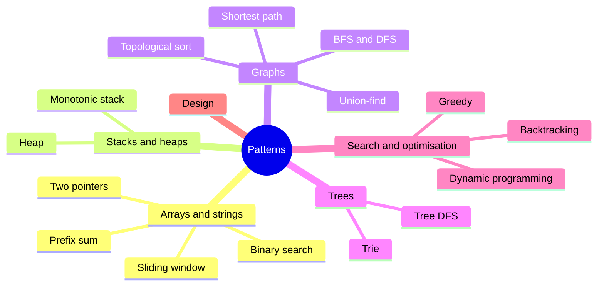

# leetcode

[](https://github.com/dkoval/leetcode/actions/workflows/ci.yml)
[](https://codecov.io/gh/dkoval/leetcode)


[](LICENSE)

Solutions to 1,300+ [LeetCode](https://leetcode.com/) algorithmic problems in Java and Kotlin, with tests.
Written for anyone studying data structures and algorithms or preparing for a coding interview.

## Study by pattern

Most interview problems are variations of a handful of patterns. Start with the examples below, then look for the same
idea in other problems.



| Pattern | Examples |
|---|---|
| Two pointers | [Container With Most Water](src/main/java/com/github/dkoval/leetcode/interview/array/ContainerWithMostWater.java), [3Sum](src/main/java/com/github/dkoval/leetcode/problems/ThreeSum.java) |
| Sliding window | [Longest Substring Without Repeating Characters](src/main/java/com/github/dkoval/leetcode/challenge/LongestSubstringWithoutRepeatingCharacters.java), [Minimum Window Substring](src/main/java/com/github/dkoval/leetcode/challenge/MinimumWindowSubstring.java) |
| Prefix sum | [Subarray Sum Equals K](src/main/kotlin/com/github/dkoval/leetcode/problems/SubarraySumEqualsK.kt) |
| Binary search | [Search in Rotated Sorted Array](src/main/java/com/github/dkoval/leetcode/problems/SearchInRotatedSortedArray.java), [Koko Eating Bananas](src/main/java/com/github/dkoval/leetcode/challenge/KokoEatingBananas.java) (search on the answer) |
| Monotonic stack | [Daily Temperatures](src/main/java/com/github/dkoval/leetcode/challenge/DailyTemperatures.java), [Largest Rectangle in Histogram](src/main/java/com/github/dkoval/leetcode/challenge/LargestRectangleInHistogram.java) |
| Heap | [Kth Largest Element in an Array](src/main/java/com/github/dkoval/leetcode/problems/KthLargestElementInArray.java), [Top K Frequent Elements](src/main/kotlin/com/github/dkoval/leetcode/challenge/TopKFrequentElements.kt), [Process Tasks Using Servers](src/main/java/com/github/dkoval/leetcode/challenge/ProcessTasksUsingServers.java) (two heaps) |
| BFS and DFS | [Number of Islands](src/main/java/com/github/dkoval/leetcode/problems/NumberOfIslands.java), [Word Ladder](src/main/java/com/github/dkoval/leetcode/interview/trees/WordLadder.java) |
| Topological sort / cycle detection | [Course Schedule](src/main/kotlin/com/github/dkoval/leetcode/challenge/CourseSchedule.kt), [Course Schedule II](src/main/kotlin/com/github/dkoval/leetcode/challenge/CourseSchedule2.kt) |
| Shortest path | [Network Delay Time](src/main/java/com/github/dkoval/leetcode/challenge/NetworkDelayTime.java) (Dijkstra), [Cheapest Flights Within K Stops](src/main/java/com/github/dkoval/leetcode/challenge/CheapestFlightsWithinKStops.java) |
| Union-find | [Redundant Connection](src/main/java/com/github/dkoval/leetcode/challenge/RedundantConnection.java) |
| Tree DFS | [Binary Tree Maximum Path Sum](src/main/java/com/github/dkoval/leetcode/interview/trees/BinaryTreeMaximumPathSum.java), [Lowest Common Ancestor of a Binary Tree](src/main/java/com/github/dkoval/leetcode/challenge/LowestCommonAncestorOfBinaryTree.java) |
| Trie | [Design Add and Search Words Data Structure](src/main/kotlin/com/github/dkoval/leetcode/challenge/AddAndSearchWordDataStructure.kt), [Word Search II](src/main/kotlin/com/github/dkoval/leetcode/challenge/WordSearch2.kt) |
| Backtracking | [Permutations](src/main/java/com/github/dkoval/leetcode/problems/Permutations.java), [N-Queens](src/main/java/com/github/dkoval/leetcode/challenge/NQueens.java) |
| Dynamic programming | [Coin Change](src/main/java/com/github/dkoval/leetcode/problems/CoinChange.java), [Longest Increasing Subsequence](src/main/java/com/github/dkoval/leetcode/challenge/LongestIncreasingSubsequence.java), [Edit Distance](src/main/kotlin/com/github/dkoval/leetcode/challenge/EditDistance.kt) |
| Greedy | [Partition Labels](src/main/kotlin/com/github/dkoval/leetcode/challenge/PartitionLabels.kt), [Gas Station](src/main/kotlin/com/github/dkoval/leetcode/challenge/GasStation.kt) |
| Design | [LRU Cache](src/main/java/com/github/dkoval/leetcode/problems/LRUCache.java) |

## How to read a solution

Most problems are a single interface named after the problem. Its Javadoc carries the problem statement, a link to
LeetCode and the constraints. Nested classes `Rev1`, `Rev2`, … are alternative approaches to the same problem, and
many of them note their time and space complexity, e.g. `// O(N) time | O(1) space`.

```java
/**
 * <a href="https://leetcode.com/problems/process-tasks-using-servers/">Process Tasks Using Servers</a>
 * <p>
 * You are given two 0-indexed integer arrays servers and tasks ...
 * <p>
 * Constraints: ...
 */
public interface ProcessTasksUsingServers {

    int[] assignTasks(int[] servers, int[] tasks);

    class ProcessTasksUsingServersRev1 implements ProcessTasksUsingServers {
        // two priority queues: free servers by (weight, index), busy servers by release time
    }
}
```

Older solutions are plain classes, and an alternative approach may live in its own file with a suffix such as `DP`
or `BottomUp` (e.g. `UniquePathsDPBottomUp`).

Nearly every solution has a matching `<ProblemName>Test` under `src/test`, mostly a parameterized JUnit test written
in Kotlin. Its test cases list inputs with expected outputs, so it is a good place to start reading.

## Finding a solution

Class names are problem titles in CamelCase, e.g. *Two Sum II - Input Array Is Sorted* → `TwoSum2InputArrayIsSorted`.

- On GitHub: press `t` and type the name.
- In IntelliJ IDEA: press `Shift` twice.
- In a terminal: `find src -name 'TwoSum*'`

## Running the tests

You need any JDK to start Gradle. The build uses a JDK 25 toolchain, and Gradle downloads it if it isn't installed.

```sh
./gradlew test                                          # all tests
./gradlew test --tests '*ProcessTasksUsingServersTest*' # one problem
```

The test run also produces a JaCoCo coverage report at `build/reports/jacoco/test/html/index.html`.

## License

The source code is available under the [MIT No Attribution License](LICENSE). You are free to use, copy, modify and
distribute it for any purpose, including commercially, without asking permission or giving credit.
